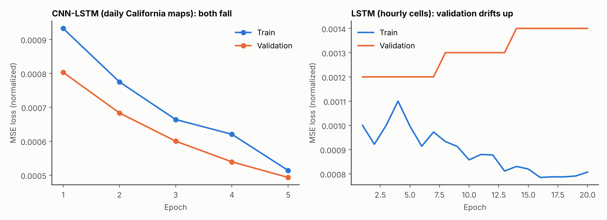
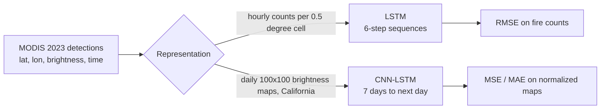

# Predicting wildfire dynamics from satellite detections

Two spatio-temporal deep-learning experiments on NASA FIRMS MODIS active-fire detections for the United States in 2023: predict where fires will appear next from the recent past.



## Approaches



| | LSTM on hourly cell counts | CNN-LSTM on daily California maps |
|---|---|---|
| Script | [`src/lstm_hourly_baseline.py`](src/lstm_hourly_baseline.py) | [`src/cnn_lstm_daily.py`](src/cnn_lstm_daily.py) |
| Input | Fire count per 0.5-degree cell per hour, a (3,246 hours x 2,768 cells) matrix, 6-step windows | Daily 100x100 grid of summed brightness over 32 to 42 N, 125 to 114 W, 7-day windows |
| Model | LSTM(64) + Dense | 2 x (TimeDistributed Conv2D + MaxPool) + LSTM(64) + Dense(10,000, sigmoid) |
| Training | 20 epochs, batch 16, chronological 80/20 split | 5 epochs, batch 3, random 80/20 split, 30% of train for validation |
| Result | RMSE 0.24 fires per cell-hour | **Test MSE 4.8e-4, MAE 0.0166** (normalized brightness) |

## What the results do and do not show

- The CNN-LSTM's train and validation loss fall together over its 5 epochs. Its test MSE (0.00048) matches the final validation loss (0.00049).
- The hourly LSTM's training loss falls while validation loss creeps from 0.0012 to 0.0014, a sign of overfitting.
- Both targets are very sparse: most cells have no fire at most times. A model that predicts near-zero everywhere would also score a low MSE or RMSE, and these notebooks do not include a persistence or all-zero baseline, so **the numbers alone do not prove the models predict fire spread**.
- The daily experiment splits windows randomly, so overlapping 7-day windows can sit on both sides of the split; a chronological split would be a stricter test.
- The first-iteration notebook had a plotting cell that reshaped predictions into a single column; the cleaner heatmap code lives in the CNN-LSTM script.

Next steps I would take: add the persistence and all-zero baselines, use a chronological split, and report precision/recall on fire-present cells instead of MSE alone.

## Run it

```bash
pip install tensorflow pandas numpy scikit-learn matplotlib
# put modis_2023_United_States.csv from NASA FIRMS in the working directory
python src/cnn_lstm_daily.py
python src/lstm_hourly_baseline.py
python make_chart.py      # redraw the curves from results/*.csv
```

## Data

NASA FIRMS MODIS active-fire detections, United States, 2023. The CSV is not included (download from NASA FIRMS). Columns: latitude, longitude, brightness, scan, track, acq_date, acq_time, satellite, instrument, confidence, version, bright_t31, frp, daynight, type.

## Notebooks

- [`Wildfire_dynamics_Prediction.ipynb`](notebooks/Wildfire_dynamics_Prediction.ipynb): the version with the LSTM and CNN-LSTM models and saved outputs.
- [`Predicting_Wildfire_Dynamics_v1.ipynb`](notebooks/Predicting_Wildfire_Dynamics_v1.ipynb): an earlier version from the previous day (a search of its cells finds no CNN-LSTM).

